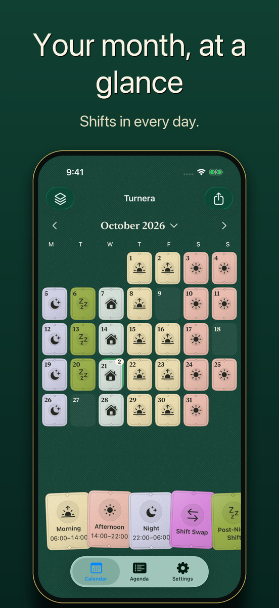
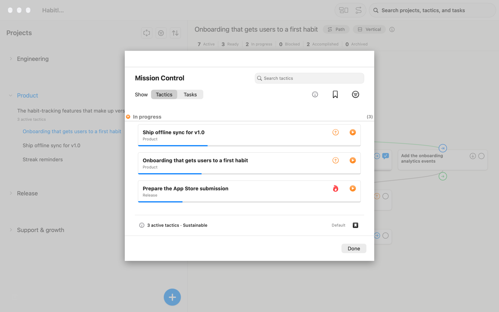

# mhjaso_public

Public information for the apps by Miguel Hernández Jaso, published as a GitHub Pages site at <https://maquert.github.io/mhjaso_public/>.

This README is the index of every public page, grouped by app. Links to pages in this repository go live when the site is published.

## Turnera

Shift calendar for iPhone, iPad and Mac.

- [Product page](https://maquert.github.io/mhjaso_public/turnera/)
- [Support](https://maquert.github.io/mhjaso_public/turnera/support/)
- [Privacy Policy](https://maquert.github.io/mhjaso_public/turnera/privacy/)

## Ecelyo

Task manager designed to work with AI agents. Its website is hosted separately from this site.

- [Website](https://ecelyo.netlify.app/)
- [Support](https://ecelyo.netlify.app/support.html)
- [Privacy Policy](https://ecelyo.netlify.app/privacy.html)

## Site

- [Products index](https://maquert.github.io/mhjaso_public/)
- [Design specification](design/SPEC.md)

New apps are added as another section above. Apps hosted in this repository use the `/<app>/`, `/<app>/support/` and `/<app>/privacy/` paths.
