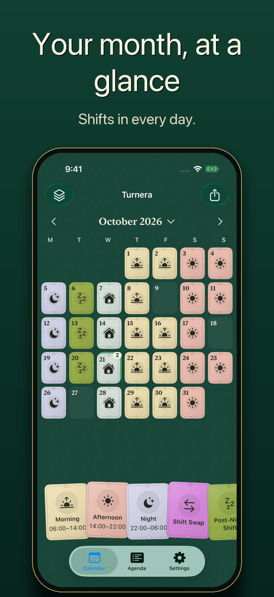
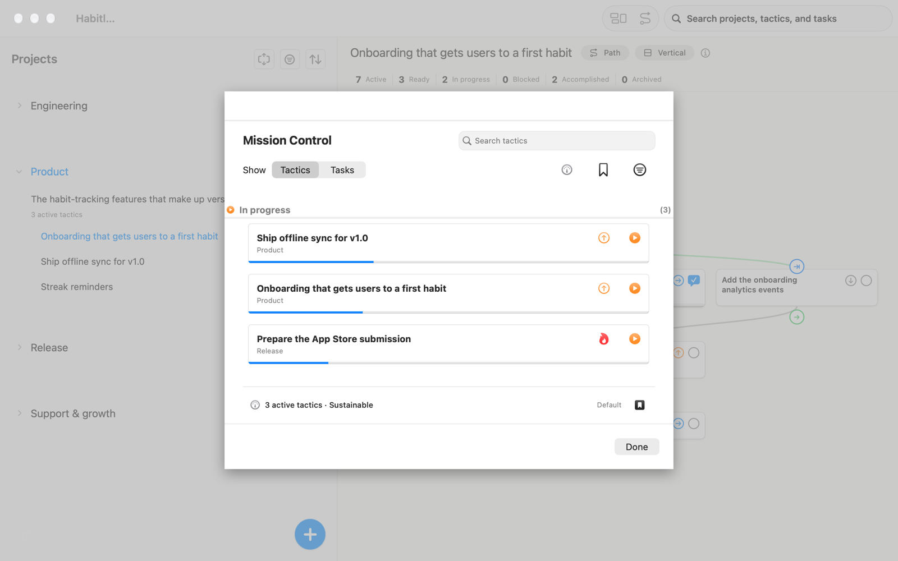

# mhjaso

Public information for the apps by Miguel Hernández Jaso, published in the **mhjaso** apps directory at <https://mhjaso.com/apps/> (this repository is `mhjaso_public`).

This README is the index of every public page, grouped by app. Links to pages in this repository go live when the site is published.

## Turnera

Shift calendar for iPhone, iPad and Mac.

- [Product page](https://mhjaso.com/apps/turnera/)
- [Support](https://mhjaso.com/apps/turnera/support/)
- [Privacy Policy](https://mhjaso.com/apps/turnera/privacy/)

## Ecelyo

Task manager designed to work with AI agents. Its website is mirrored under the mhjaso site.

- [Website](https://mhjaso.com/ecelyo/)
- [Support](https://mhjaso.com/ecelyo/support/)
- [Privacy Policy](https://mhjaso.com/ecelyo/privacy/)

## Site

- [Products index](https://mhjaso.com/apps/)
- [Design specification](design/SPEC.md)

New apps are added as another section above. Apps hosted in this repository use the `/<app>/`, `/<app>/support/` and `/<app>/privacy/` paths.
